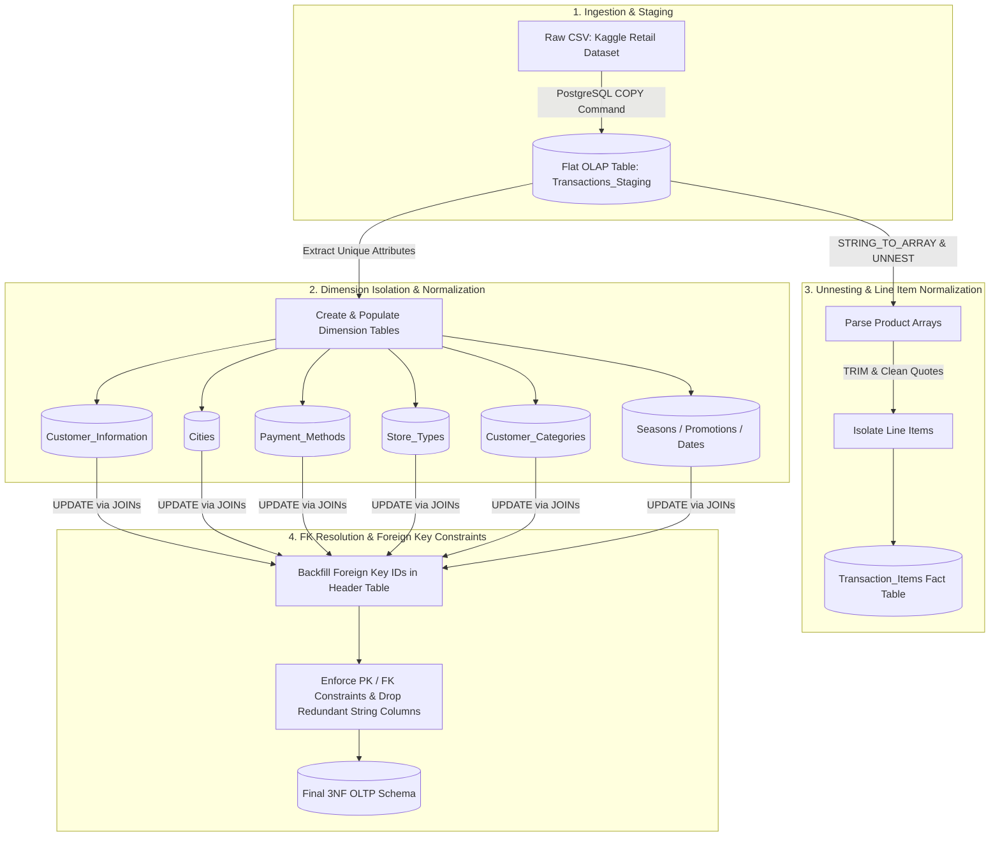
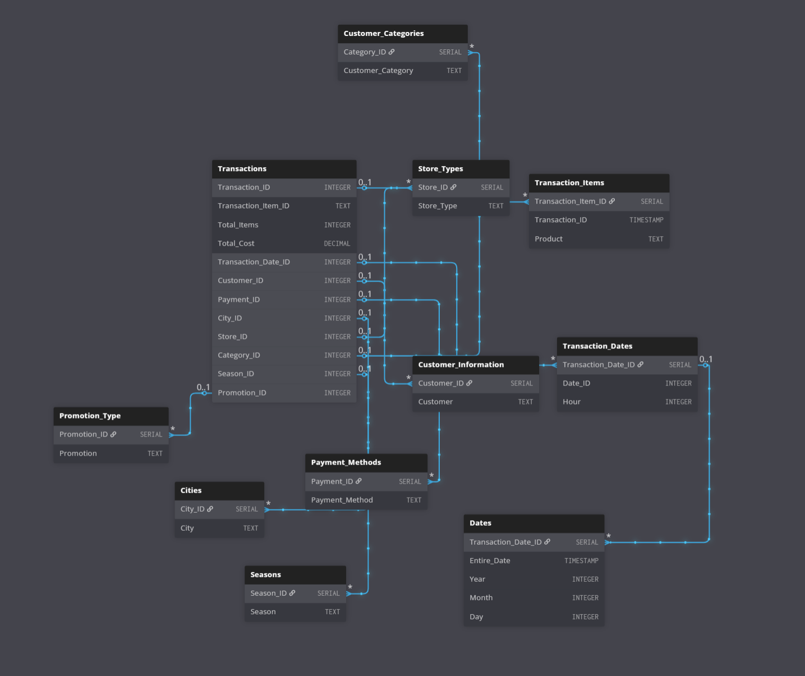

# OLAP to OLTP Database Normalization & Schema Transformation

A database engineering project focused on restructuring a multi-million row denormalized OLAP wide-table into a Third Normal Form (3NF) transactional OLTP relational schema using advanced PostgreSQL SQL DDL/DML, dynamic array unnesting, string cleansing, and surrogate key backfilling.

---

## Executive Summary

* **Objective:** Deconstruct a flat, single-table analytical dataset into a normalized relational model to eliminate data redundancy, enforce strict referential integrity, and optimize operational write performance.
* **Source Dataset:** Retail Transactions Dataset (Millions of records, single wide table containing transaction, customer, product array, payment, and location metadata).
* **Target Engine:** PostgreSQL
* **Core Techniques:** SQL DDL/DML, `UNNEST()`, `STRING_TO_ARRAY()`, string sanitization, surrogate key generation, Foreign Key constraint enforcement.

---

## Problem Statement & Context

Flat OLAP tables (such as raw exports or analytical staging tables) are efficient for read-only aggregation queries but present severe operational drawbacks in transactional environments:

1. **Massive Redundancy:** Repeated string storage for attributes like customer names, store locations, and promotions across millions of rows leads to storage bloat.
2. **Update & Ingestion Anomalies:** Modifying a single dimension (e.g., updating a city or customer name) requires updating millions of records.
3. **Unstructured Data Fields:** Products were stored as stringified arrays (`['Product A', 'Product B']`), violating First Normal Form (1NF) and preventing line-item granular querying or stock control.

This project executes an in-place database transformation to resolve these anomalies by establishing a normalized 3NF OLTP architecture.

---

## High-Level Architectural Flow

The ingestion and normalization process transitions the dataset from a flat file staging table into a multi-entity relational schema.



---

## Schema Evolution & ERD Mapping

### Staging (Denormalized OLAP Table)
```
+-----------------------------------------------------------------------------------+
|                               TRANSACTIONS_STAGING                                |
+-----------------------------------------------------------------------------------+
| Transaction_ID (PK)  | BIGINT       | Unique transaction identifier               |
| Date                 | TIMESTAMP    | Transaction timestamp                       |
| Customer_Name        | TEXT         | Unnormalized customer string                |
| Product              | TEXT         | Stringified array e.g. ['Prod A', 'Prod B'] |
| Total_Items          | INTEGER      | Aggregated item count                       |
| Total_Cost           | DECIMAL      | Aggregated transaction cost                 |
| Payment_Method       | TEXT         | Payment method string                       |
| City                 | TEXT         | City location string                        |
| Store_Type           | TEXT         | Store classification string                 |
| Customer_Category    | TEXT         | Demographics classification                 |
| Season               | TEXT         | Seasonal tag                                |
| Promotion            | TEXT         | Promotion identifier                        |
+-----------------------------------------------------------------------------------+
```

### Target (3NF Relational OLTP Schema)
The denormalized wide table is decomposed into a core header table (`Transactions`), a line-item transaction detail table (`Transaction_Items`), and supporting dimension tables linked via Foreign Keys.



---

## Transformation & In-Place Normalization Logic

### 1. Line-Item Unnesting & Parsing (1NF Enforcement)
The raw `Product` column contained stringified Python/JSON arrays (e.g., `['Shirt', 'Shoes']`). Using PostgreSQL array manipulation functions, the string brackets were stripped, converted to standard PostgreSQL arrays, unnested into atomic rows, and trimmed of single quote artifacts.

```sql
-- Step A: Parse array string and unnest into line-item table
CREATE TABLE Transaction_Items (
   Transaction_Item_ID SERIAL PRIMARY KEY,
   Transaction_ID BIGINT,
   Product TEXT
);

INSERT INTO Transaction_Items (Transaction_ID, Product)
SELECT 
    Transaction_ID,
    UNNEST(STRING_TO_ARRAY(TRIM(BOTH '[]' FROM Product), ','))::TEXT
FROM Transactions_Staging;

-- Step B: Clean quotation whitespace around extracted string attributes
UPDATE Transaction_Items
SET Product = TRIM(BOTH '''' FROM TRIM(Product));
```

### 2. Dimension Extraction & Surrogate Key Generation
Unique dimension records were extracted from the staging dataset to generate lookups with integer surrogate primary keys.

```sql
-- Example: Creating the Cities Lookup Dimension
CREATE TABLE Cities (
    City_ID SERIAL PRIMARY KEY,
    City TEXT UNIQUE NOT NULL
);

INSERT INTO Cities (City)
SELECT DISTINCT City 
FROM Transactions_Staging 
WHERE City IS NOT NULL;
```

### 3. Foreign Key Resolution & Backfilling
Once dimension tables were generated, foreign key reference columns were added to the main transaction header table and backfilled using optimized multi-table `UPDATE ... FROM` joins.

```sql
-- Adding FK reference columns
ALTER TABLE Transactions 
    ADD COLUMN Customer_ID INT,
    ADD COLUMN City_ID INT,
    ADD COLUMN Payment_ID INT,
    ADD COLUMN Store_ID INT,
    ADD COLUMN Category_ID INT,
    ADD COLUMN Transaction_Date_ID INT;

-- Backfilling Foreign Key references
UPDATE Transactions T
SET Customer_ID = CI.Customer_ID
FROM Customer_Information CI
WHERE T.Customer_Name = CI.Customer;

UPDATE Transactions T
SET City_ID = C.City_ID
FROM Cities C
WHERE T.City = C.City;

UPDATE Transactions T
SET Payment_ID = PM.Payment_ID
FROM Payment_Methods PM
WHERE T.Payment_Method = PM.Payment_Method;
```

### 4. Constraint Enforcement & Schema Cleanup
After resolving foreign keys, redundant string columns were removed and relational integrity constraints were explicitly declared.

```sql
-- Remove redundant unnormalized columns
ALTER TABLE Transactions
    DROP COLUMN Customer_Name,
    DROP COLUMN City,
    DROP COLUMN Payment_Method,
    DROP COLUMN Store_Type,
    DROP COLUMN Product;

-- Enforce Foreign Key Constraints
ALTER TABLE Transactions
    ADD CONSTRAINT fk_transactions_customer 
        FOREIGN KEY (Customer_ID) REFERENCES Customer_Information(Customer_ID),
    ADD CONSTRAINT fk_transactions_city 
        FOREIGN KEY (City_ID) REFERENCES Cities(City_ID);

ALTER TABLE Transaction_Items
    ADD CONSTRAINT fk_items_transaction 
        FOREIGN KEY (Transaction_ID) REFERENCES Transactions(Transaction_ID);
```

---

## Technical Trade-Offs & Architectural Decisions

* **Normalization Overhead vs. Data Integrity:** Transitioning to 3NF eliminates redundant string storage and guarantees ACID compliance for write operations. However, analytical read queries now require multi-table `JOIN` operations, introducing query complexity for reporting work.
* **Header-Level vs. Line-Item Level Metrics:** Due to source data limitations where total costs were reported at the header level (`Total_Cost`, `Total_Items`), line items were isolated into `Transaction_Items` for product frequency tracking, while monetary aggregates were preserved at the parent transaction level to prevent synthetic pricing distortion.
* **Bulk Import Strategy:** Utilizing native PostgreSQL `COPY` direct protocol for staging provided optimal throughput over single-row row-by-row inserts when handling multi-million record CSV imports.