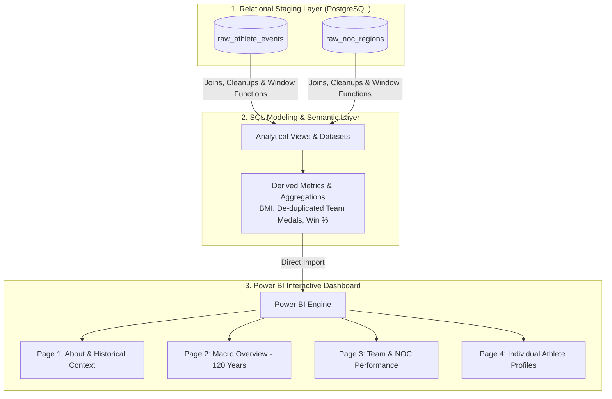

# 120 Years of Olympic Games Analytics Dashboard

An interactive, multi-page **Power BI Analytics Dashboard** powered by a **PostgreSQL** relational semantic layer. The project models 120 years of historical Olympic data (1896–2016)—encompassing athlete demographics, event results, NOC regions, and medal tallies—into optimized SQL analytical views before visualizing macro trends, country-level dominance, and individual athlete achievements.

---

## Executive Summary

* **Business Focus:** Longitudinal athletic performance tracking, team/NOC dominance analysis, physical demographic profiling (BMI, height, age distributions), and granular individual athlete histories.
* **Architecture Pattern:** Database-First Semantic Layer (PostgreSQL Transformations $\rightarrow$ Power BI Analytical Views).
* **Data Source:** [Maven Analytics - Olympic Games Dataset](https://www.mavenanalytics.io/) (Athens 1896 to Rio 2016).
* **Core Stack:** PostgreSQL, SQL (DDL/DML, Window Functions, Case Aggregations), Power BI (Multi-Page Navigation, Dynamic Filtering, Demographic Modeling).

---

## System Architecture & Pipeline Design

Raw historical records are ingested and transformed directly within **PostgreSQL**. Pushing demographic derivations (such as BMI calculations) and multi-level aggregations to the database layer optimizes reporting performance and ensures consistency across all dashboard views.



---

## Data Model & Relational Schema

The raw dataset maps athlete participation events to National Olympic Committees (NOCs) across 120 years of competition:

```text
+-----------------------------------+        +----------------------+
|          ATHLETE_EVENTS           |        |     NOC_REGIONS      |
+-----------------------------------+        +----------------------+
| id (PK)                           |   >----| noc (PK)             |
| name                              |        | region               |
| sex                               |        | notes                |
| age                               |        +----------------------+
| height                            |
| weight                            |
| team                              |
| noc (FK)                          |
| games                             |
| year                              |
| season                            |
| city                              |
| sport                             |
| event                             |
| medal                             |
+-----------------------------------+
```

---

## SQL Transformations & Metric Engineering

Key analytical views and formulas engineered directly inside PostgreSQL:

### 1. BMI Derivation & Demographic Profiling
```sql
SELECT 
    id AS athlete_id,
    name,
    sex,
    age,
    height,
    weight,
    -- BMI Formula: Weight (kg) / (Height (m))^2
    ROUND(
        (weight / POWER(height / 100.0, 2))::numeric, 2
    ) AS bmi,
    sport,
    event,
    medal
FROM athlete_events
WHERE height IS NOT NULL AND weight IS NOT NULL;
```

### 2. De-duplicated Event-Level Team Medal Aggregation
To ensure team sports (e.g., Basketball, Relay) are counted as a single medal for the country rather than multiplying per athlete entry:

```sql
SELECT 
    year,
    season,
    noc,
    sport,
    event,
    medal,
    COUNT(DISTINCT CONCAT(year, season, event, medal, noc)) AS team_event_medals
FROM athlete_events
WHERE medal IS NOT NULL AND medal != 'NA'
GROUP BY year, season, noc, sport, event, medal;
```

---

## Dashboard Architecture & Features

The Power BI report provides four distinct analytical lenses:

* **Page 1: About:** Overview of modern Olympic history, data scope, and field definitions.
* **Page 2: Overview (120-Year Macro View):** High-level metrics showing total participating athletes, medal distributions, total teams, top-performing sports, and annual medal trends from 1896 to 2016.
* **Page 3: Teams (NOC Deep-Dive):** Country-level performance analysis including medal win percentages, sport-by-sport dominance, and historical edition trends.
* **Page 4: Athletes (Individual Profiles):** Micro-level drill-down displaying athlete demographics (Age, Height, Weight, BMI), historical games attended, sports played, and medal breakdowns.

---

## Technical Trade-Offs & Key Decisions

* **Null Value Retention:** Kept null values intact in physical metrics (`Age`, `Height`, `Weight`) to avoid distorting historical averages for early Olympic games where physical stats were unrecorded.
* **SQL Semantic Derivation:** Pushed BMI calculations and event-level medal de-duplication to PostgreSQL views to simplify the Power BI DAX layer and keep report filtering fast and responsive.