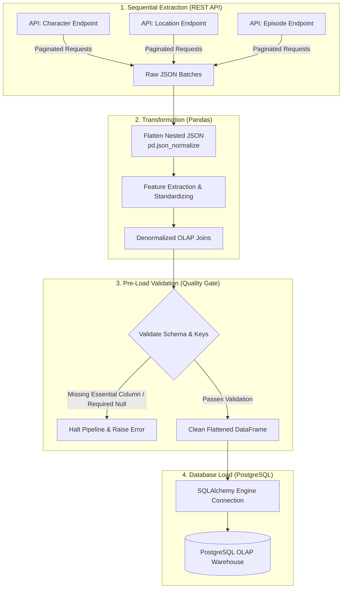

# Rick and Morty ETVL Data Pipeline

A Python-based **ETVL (Extract, Transform, Validate, Load)** pipeline designed to extract canonical show data from the RESTful Rick and Morty API, transform nested JSON objects into flattened analytical models using `pandas`, execute strict pre-load data validation, and populate an OLAP PostgreSQL database via `SQLAlchemy`.

---

## Executive Summary

* **Pipeline Pattern:** Sequential ETVL (Extract $\rightarrow$ Transform $\rightarrow$ Validate $\rightarrow$ Load)
* **Data Source:** [Rick and Morty REST API](https://rickandmortyapi.com/) (`character`, `location`, `episode` endpoints)
* **Target Storage:** PostgreSQL (OLAP Flat Table Structure)
* **Core Stack:** Python 3.x, `requests`, `pandas`, `SQLAlchemy`, PostgreSQL

---

## System Architecture

The pipeline processes API endpoints sequentially. Unlike standard ETL patterns, this architecture introduces an explicit **Validate (V)** layer before loading. If any validation rule fails on essential fields, the pipeline immediately halts execution to maintain target database integrity.



---

## Pipeline Execution Flow

### 1. Extract (E)
* Iterates sequentially across the `character`, `location`, and `episode` endpoints.
* Handles API pagination dynamically, making HTTP requests via `requests` until all pages are retrieved.

### 2. Transform (T)
* Flattens multi-level nested JSON structures (such as character `origin`, `location`, and endpoint arrays) using `pandas.json_normalize()`.
* Joins entity datasets into a unified, denormalized OLAP schema optimized for direct analytical querying without requiring complex runtime join operations.

### 3. Validate (V)
* **Pre-Load Data Quality Gate:** Inspects the transformed DataFrame against required column specifications and data types prior to touching the database.
* **Null Tolerance Handling:** Allows `NULL` values strictly on non-essential metadata columns. Essential keys (e.g., primary identifiers, core names) must be present.
* **Fail-Fast Error Mechanism:** If a required field fails validation, an exception is raised, and the execution terminates instantly to protect target storage from dirty or partial writes.

### 4. Load (L)
* Manages database connections securely using `SQLAlchemy`.
* Bulk loads the validated analytical dataset directly into local PostgreSQL tables.

---

## Technical Stack & Justifications

| Component Layer | Technology Chosen | Business / Operational Justification |
| :--- | :--- | :--- |
| **Ingestion** | `requests` | Lightweight, reliable REST API consumption and response handling. |
| **Transformation** | `pandas` | In-memory data manipulation, JSON normalization, and joining multi-entity datasets. |
| **Validation** | Custom Python Logic | Fail-fast schema/null enforcement preventing database pollution. |
| **Database ORM** | `SQLAlchemy` | Robust relational database connection pooling and seamless `pandas` integration. |
| **Target Warehouse** | PostgreSQL | Local relational/OLAP storage structured for analytical querying. |

---

## Data Model (OLAP Structure)

Rather than maintaining a strict normalized 3NF relational schema with relational foreign key constraints, the pipeline combines attributes into a **denormalized OLAP table structure**. This reduces query complexity for downstream analysis and reporting.

```
+-----------------------------------------------------------------------------------+
|                            FACT_CHARACTER_ANALYTICS                               |
+-----------------------------------------------------------------------------------+
| id (PK)              | INT          | Unique character identifier                 |
| name                 | VARCHAR      | Character name                             |
| status               | VARCHAR      | Status ('Alive', 'Dead', 'unknown')        |
| species              | VARCHAR      | Species name                               |
| type                 | VARCHAR      | Subspecies/Type (Nullable)                 |
| gender               | VARCHAR      | Gender classification                      |
| origin_name          | VARCHAR      | Flattened origin location name             |
| location_name        | VARCHAR      | Flattened last known location name         |
| location_type        | VARCHAR      | Dimension / Type of last location          |
| episode_appearances  | INT          | Calculated count of episode appearances    |
| created_at           | TIMESTAMP    | Ingestion timestamp                        |
+-----------------------------------------------------------------------------------+
```

---

## Technical Trade-Offs & Decisions

* **Denormalization vs. 3NF:** Opted for a flattened OLAP structure over separate relational tables. While this introduces redundant dimensional strings, it accelerates read query performance and simplifies consumption for data visualization tools.
* **Sequential vs. Parallel Extraction:** Endpoints are extracted sequentially rather than concurrently. Given the API payload sizes, sequential execution guarantees deterministic order and simplifies rate-limit safety without requiring complex asynchronous event loops.
* **Fail-Fast Execution:** Strict pipeline termination on validation failure prioritizes **data consistency over availability**, avoiding silent failure modes or corrupted analytics tables.

---